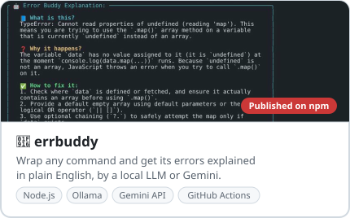
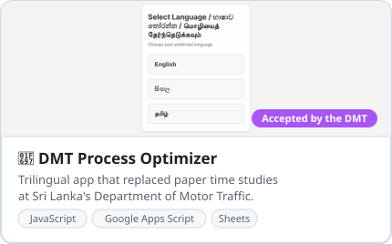
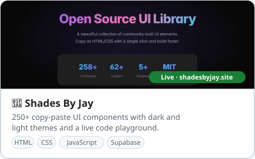
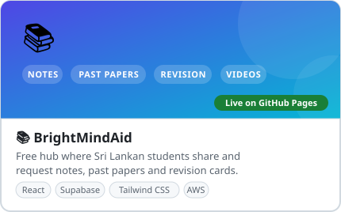
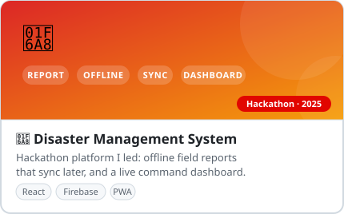

  <picture>
    <source media="(prefers-color-scheme: dark)" srcset="./assets/header-dark.svg">
    
  </picture>

  
  
  
  

## 🏁 Career telemetry

  <picture>
    <source media="(prefers-color-scheme: dark)" srcset="./assets/career-dark.svg">
    
  </picture>

At **Acumen Intelligence** I build production apps end to end: a lead-management CRM, a client review portal and a Flutter workplace app. On **BuildFlow** I lead a 10-developer team building a construction ERP with Angular, Spring Boot and MySQL.

## 🛠️ Shipped

  <a href="https://github.com/sithija-jayasinghe/errbuddy"><picture><source media="(prefers-color-scheme: dark)" srcset="./assets/card-errbuddy-dark.svg"></picture></a>
  <a href="https://github.com/sithija-jayasinghe/DMT"><picture><source media="(prefers-color-scheme: dark)" srcset="./assets/card-dmt-dark.svg"></picture></a>

  <a href="https://shadesbyjay.site/"><picture><source media="(prefers-color-scheme: dark)" srcset="./assets/card-shades-dark.svg"></picture></a>
  <a href="https://github.com/sithija-jayasinghe/BrightMindAid"><picture><source media="(prefers-color-scheme: dark)" srcset="./assets/card-brightmindaid-dark.svg"></picture></a>

  <a href="https://github.com/NethmiAsinsala/Hackathon-Web-App"><picture><source media="(prefers-color-scheme: dark)" srcset="./assets/card-disaster-dark.svg"></picture></a>

## 🧰 Toolbox

**Languages** &nbsp; Java · JavaScript · TypeScript · Python · Dart · C# · SQL 
**Frontend** &nbsp; React · Next.js · Angular · Vue 3 · Tailwind CSS · Flutter 
**Backend** &nbsp; Spring Boot · Node.js · Express · Flask · .NET 
**Data & DevOps** &nbsp; MySQL · PostgreSQL · MongoDB · Firebase · Supabase · Docker · Jenkins · GitHub Actions

## 🏎️ Off the keyboard

Formula 1 · Fitness · Cars · New tech products
